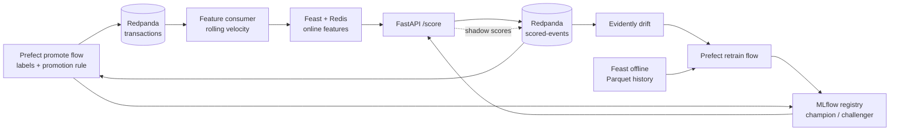

# fraud-stream

Streaming fraud detection on the IEEE-CIS dataset: replayed transactions flow through Redpanda, rolling
features are materialised to Redis with Feast, and a LightGBM model is chosen by expected business cost
rather than a 0.5 threshold. The end goal is p95 scoring latency under 80 ms with drift-triggered,
shadow-tested retraining.

> **Status (Week 4 of 4).** Data, modelling, feature store, streaming ingestion, scoring API, model
> registry, Prometheus/Grafana monitoring, drift detection, a Prefect retrain flow, shadow mode and a
> promotion rule are built; 40 tests pass. Scoring p95 is 35-80 ms up to 400 req/s and 89 ms at 600
> (see [Serving](#serving)). One full drift, retrain, shadow, promote cycle has been run on injected drift
> (see [Retraining and promotion](#retraining-and-promotion)); the automatic drift trigger did not fire
> at the right time in it, and the retrain was forced. CI is written but has not run on GitHub.
> See [Roadmap](#roadmap). Numbers marked _pending_ have not been
> measured; none are estimated.

## Architecture



Everything shown exists. The dotted line is shadow mode: the API also scores the `challenger` model,
logs its score next to the champion's in `scored-events`, and never acts on it.

## Quickstart

Requires Python 3.11, Docker, and a Kaggle token with the
[IEEE-CIS competition rules](https://www.kaggle.com/c/ieee-fraud-detection/rules) accepted.

```powershell
# 1. environment
uv venv --python 3.11 .venv
uv pip install --python .venv\Scripts\python.exe -r requirements.txt

# 2. data: download train_transaction.csv and train_identity.csv into data/raw/, then
make data        # merge, validate, time-split 70/15/15 -> data/processed/*.parquet
make features    # rolling velocity features + `feast apply`

# 3. models
make train                           # logistic regression vs LightGBM v1 (validation)
.venv\Scripts\python -m src.training.tune 20   # Optuna, cost-based threshold, report on replay

# 4. streaming
docker compose up -d                 # Redpanda + Redis
.venv\Scripts\python -m src.ingestion.producer --rate 200 --limit 3000
.venv\Scripts\python -m src.ingestion.consumer --max-events 3000
.venv\Scripts\python -m src.ingestion.check_online   # online vs offline feature check

# 5. tests
make test
```

When re-running a replay, flush Redis first (`docker compose exec redis redis-cli FLUSHALL`). Feast's
Redis store ignores writes that are not newer than what it holds, so old values would otherwise stay.

## Results

All evaluation is time-based: oldest 70% train, next 15% validation, newest 15% "replay" (live) split.
Hyperparameters and thresholds are chosen on validation; the replay split is only used for final numbers.

| Metric | Logistic regression | LightGBM v1 (untuned) | LightGBM tuned |
|---|---|---|---|
| PR-AUC, validation | 0.385 | 0.607 | 0.654 |
| Recall at 1% FPR, validation | 0.319 | 0.519 | _not logged_ |
| PR-AUC, replay | 0.167 | _not run_ | 0.565 |
| Recall at 1% FPR, replay | 0.005 | _not run_ | 0.486 |
| Expected cost, replay | 209,842 | _not run_ | 150,934 |

Cost of flagging nothing on the replay split: 469,609. The tuned model cuts expected cost by 28.1%
against the logistic regression baseline (threshold chosen on validation by minimising cost).

Tuned model: 20 Optuna trials, class weight `scale_pos_weight=10`, 1,490 trees. That search hit its
edges (1,490 of a 1,500-tree cap, `scale_pos_weight` at the largest option offered, `feature_fraction`
near its 0.9 limit); the wider search, ablation, focal loss, cost and label-delay experiments in
[Closing the limitations](#closing-the-limitations) followed up on that. The drop from 0.654
(validation) to 0.565 (replay) is consistent with the drift noted below, and part of it is
validation-set tuning.

Notes on these numbers:

- Logistic regression uses numeric columns only; part of its gap to LightGBM is feature handling,
  not just model class.
- Its drop from 0.385 (validation) to 0.167 (replay) shows real drift between older and newer data.
- Expected cost = amount of missed fraud + a fixed review cost per false alarm
  ([cost_matrix.py](src/training/cost_matrix.py), currently 5.0 per false alarm).

### Threshold

The decision threshold is chosen by minimising expected cost on validation, not fixed at 0.5. For the
tuned model it comes out at **0.002**. That is low because a false alarm is assumed to cost a flat 5.0
while a missed fraud costs the full transaction amount. This is an assumption, not a measured result:
a real review cost would move the threshold, and in a business the owner of that cost decides it.

### Explainability

[src/training/explain.py](src/training/explain.py) returns the top 3 features pushing a score towards
fraud, using LightGBM's native TreeSHAP (`pred_contrib=True`). Example for a high-scoring replay
transaction that was fraud: `C13` (+3.01), `DeviceInfo` (+2.62), `C1` (+1.60). Most IEEE-CIS columns
(`C*`, `V*`) are anonymised, so the reasons are correct but not human-readable. Check it with
`python -m src.training.try_explain`.

| Check | Result |
|---|---|
| Online (Redis) vs offline (Parquet) card features, 200 cards after 3,000 replayed events | max abs diff 1.8e-12 |
| Feature parity unit test, 20,000 events, 3 entity types | passing |
| p50 / p95 / p99 scoring latency | 23 / 35 / 46 ms at 100 req/s; 24 / 80 / 110 ms at 400 req/s; see [Serving](#serving) |
| Drift alert to promoted model | run once end to end on injected drift; retrain was forced (the trigger did not fire in time), challenger v5 cut shadow cost 39.2% and was promoted; elapsed time not measured, see [Retraining and promotion](#retraining-and-promotion) |

## Closing the limitations

Produced by [src/training/caveats.py](src/training/caveats.py) (`python -m src.training.caveats`), same
protocol as above: fit on train, tune and pick the threshold on validation, report on replay. Raw output
is in `data/processed/caveats_results.json`. Single machine, CPU only; the search took about 3 hours.

**Wider search.** 30 trials, up to 4,000 trees, `scale_pos_weight` 1-50 (continuous), `feature_fraction`
0.1-1.0, `num_leaves` 15-511, `lambda_l2` up to 100. The best trial stopped at 2,321 trees (under the cap)
with `scale_pos_weight` 28.1, `feature_fraction` 0.87 and `num_leaves` 368, all inside their ranges.

| | Tuned v1 (20 trials) | Wider search (30 trials) |
|---|---|---|
| PR-AUC, validation | 0.654 | 0.673 |
| PR-AUC, replay | 0.565 | 0.579 |
| Recall at 1% FPR, replay | 0.486 | 0.506 |
| Expected cost, replay | 150,934 | 155,001 |
| Share of replay flagged | not logged | 13.4% |

The wider search ranks better but is not cheaper: cost is 2.7% higher. That gap is about the size of
seed-to-seed noise (see the ablation below, cost standard deviation 2,000-3,000 across seeds), so the two
models are not distinguishable on cost. It is saved as `model_v2.txt`; `model_v1` is still the model the
other numbers in this README refer to. The very low v2 threshold (7e-6) follows from the high class
weight. Each model was tuned once with one seed.

**Velocity features (ablation).** Same tuned parameters, 3 seeds, mean ± std on replay:

| | PR-AUC | Recall at 1% FPR | Cost |
|---|---|---|---|
| With the 12 velocity features | 0.5819 ± 0.0020 | 0.512 ± 0.003 | 156,670 ± 2,202 |
| Without them | 0.5819 ± 0.0016 | 0.508 ± 0.002 | 154,863 ± 3,177 |

No measurable contribution on this data: PR-AUC is identical and the cost difference is inside the noise.
The velocity features may matter for other fraud patterns or for live serving, but nothing here shows it,
and the model does not depend on them.

**Focal loss.** Custom LightGBM objective, gamma in {1, 2} x alpha in {0.5, 0.75, 0.9}, other parameters
from the wider search. Replay PR-AUC across the six runs is 0.577-0.582 and cost 153,601-160,342, against
0.579 and 155,001 for the class-weighted model. The best on validation (gamma 2, alpha 0.5) gives replay
PR-AUC 0.580 and cost 159,372. Focal loss is implemented and tested; it gives no gain here.

**Review cost.** The wider-search model, threshold re-chosen on validation for each assumed cost per false
alarm:

| Review cost | Share flagged | Replay cost | Saving vs flagging nothing |
|---|---|---|---|
| 1 | 41.3% | 76,523 | 83.7% |
| 5 (default) | 13.4% | 155,001 | 67.0% |
| 10 | 9.5% | 201,642 | 57.1% |
| 25 | 5.6% | 266,440 | 43.3% |
| 50 | 4.2% | 317,761 | 32.3% |
| 100 | 3.0% | 365,208 | 22.2% |

The cost assumption moves the operating point far more than model changes do. The 5.0 default is still an
assumption; the business owner of that cost should set it.

**Delayed labels (simulation).** Training rows from the last N days before the validation split are
dropped, as if their fraud labels had not arrived yet. Validation and the threshold choice are unchanged.

| Label delay | Training rows | Fraud in training | PR-AUC, replay | Recall at 1% FPR | Cost |
|---|---|---|---|---|---|
| 0 days | 413,378 | 14,538 | 0.580 | 0.506 | 155,001 |
| 7 days | 391,716 | 13,461 | 0.570 | 0.490 | 159,866 |
| 14 days | 370,798 | 12,590 | 0.556 | 0.481 | 158,083 |
| 30 days | 314,882 | 10,655 | 0.534 | 0.458 | 185,653 |

A month of label delay costs about 8 PR-AUC points and 20% more expected cost. This is a simulation with
one seed: real delays vary by fraud type, and the cost at 7 and 14 days is not monotonic, so treat the
small differences as noise.

## Serving

```powershell
docker compose up -d                 # Redpanda, Redis, Prometheus (:9090), Grafana (:3000)
make register                        # MLflow: model_v1 -> champion, model_v2 -> challenger
make serve                           # API on :8000, 4 worker processes
make replay-score                    # put replay features in Redis, score via the API, check parity
make drift-baseline; make drift      # drift thresholds, then follow scored-events
make loadtest                        # fixed-rate latency matrix (needs replay-score first)
```

Endpoints: `POST /score` (score + flag), `POST /explain` (top-k SHAP, slow, flagged transactions only),
`POST /reload` (re-read the registry aliases now), `GET /health`, `GET /metrics`.
The model is whatever holds the `champion` alias. `/reload` only reaches the one worker that handles
the request, so every worker also polls the registry every 15 s (`ALIAS_POLL_S`) and reloads itself when
an alias moves; a reload takes 25-40 s to finish across four workers. After a promotion made with no
`/reload` call, all four workers were seen serving the new champion. Scored events go to Redpanda for drift monitoring,
and if Feast/Redis is unavailable `/score` returns 503 rather than guessing a score.

**Latency** (Locust, fixed request rate, 4 workers, single machine, replay transactions, one run per
rate, milliseconds):

| Target req/s | Achieved | p50 | p95 | p99 | Failed requests |
|---|---|---|---|---|---|
| 100 | 100 | 23 | 35 | 46 | 0 |
| 200 | 199 | 33 | 51 | 69 | 0 |
| 400 | 392 | 24 | 80 | 110 | 0 |
| 600 | 570 | 39 | 89 | 190 | 0 |

(`loadtest/results/run2/`; the drift monitor was not running, and Locust shares the machine with the
API.) The 80 ms p95 goal holds up to 200 req/s, is borderline at 400 and is missed at 600. Each step is
one 70 s run including the ramp, so differences of a few ms are noise, and the p50 not rising smoothly
(33 ms at 200, 24 ms at 400) shows how noisy single runs are. An earlier matrix
(`loadtest/results/final/`) fell short of the target rate at 200 and 400 req/s with bursts of dropped
connections; that was not reproduced and its cause was not found, so only `run2` is reported here.

Serving/offline parity: replaying 3,000 events through the API gives scores identical to the offline
model (max abs diff 0, 0 decision mismatches). Flush Redis before `make replay-score`: Feast ignores
writes that are not newer than what Redis already holds, and on stale data the same check showed
121 of 3,000 decision mismatches.

`/explain` is not on the scoring path: its earlier load test (68 requests, `results/final/explain.log`)
had a median of 480 ms but a p95 and p99 of 15,000 ms, which has not been investigated or re-run.

## Retraining and promotion

```powershell
# scenario in src/pipelines/scenario.py: replay events [0, 8000) healthy, drifted from 8000,
# labels known for [0, 20000), challenger shadows the champion on [20000, 40000)
docker compose exec redis redis-cli FLUSHALL
make serve; make drift               # champion API, drift monitor
make stream-phase1                   # events 0-20000 with injected drift
make retrain                         # Prefect flow: fires only if the drift trigger holds (--force to override)
make serve-shadow                    # restart the API with the challenger scored in shadow
make stream-phase2                   # events 20000-40000
make promote                         # Prefect flow: compare on labels, apply the rule, promote + reload if it passes
```

**Injected drift** ([drift_injection.py](src/pipelines/drift_injection.py)). From event 8,000 the
transaction amount is multiplied by 2.5 and the model's three most important numeric inputs (`V258`, `C14`,
`card1`) by 2.0. It is applied before velocity features are computed, so the Redis features, the scored
payload and the retraining data all see the same shifted world. Fraud labels are not touched.

**Trigger** ([retrain_flow.py](src/pipelines/retrain_flow.py)). Retrain only if the last 3 drift
evaluations of the serving model all alerted. In this run the trigger was a weak signal:

- 79 evaluations, 36 alerts. The first three in a row came at about event 6,750, before any injection:
  the replay split has natural drift against the validation reference.
- During the injection the injected columns are clearly out (e.g. `TransactionAmt` distance 0.5-1.2 against
  a calibrated threshold of 0.18), but the alerting share of columns hovers around the 25% limit, flickers,
  and was below it for the last ~15 evaluations (events ~16,000-20,000) although the shift continued. A shift
  that touches 3 inputs and their derived velocity sums sits near that share limit by construction.
- At the labelling cutoff the flow correctly reported "trigger not fired", so the retrain was run with
  `--force`. I did not tune the monitor on this scenario. Whether a different rule (share over several
  windows, per-feature alerts, score drift) would be better is open.

**Retrain** (forced). Same hyperparameters and tree count as the champion (read from its MLflow run), fit on
train + validation + labelled replay before event 14,800 (517,159 rows, 18,040 frauds); the threshold is the
cost minimum on the newest labelled slice, events 14,800-20,000 (4,800 rows, 132 frauds), as for the champion.
It took 266 s on CPU and was registered as version 5 under the `challenger` alias. Labels were treated as
available immediately, with no simulated delay.

**Promotion rule** ([promotion.py](src/pipelines/promotion.py)). The challenger is promoted only if all hold, on
labelled shadow events: at least 5,000 events and 100 frauds; expected cost at least 2% below the champion's
and the lower end of a 95% paired-bootstrap interval of that saving above zero; PR-AUC no more than 0.005 worse;
flag rate within 0.5x-2x of the champion's. Each failed check is listed, and every run is appended to
`reports/promotions.jsonl`. The thresholds are my choices, not calibrated.

**Shadow result** (events 20,000-40,000, none used in training; one run, one seed):

| | Champion v3 | Challenger v5 | Champion, threshold re-tuned only |
|---|---|---|---|
| Expected cost | 74,199 | 45,093 | 69,921 |
| Saving vs champion | | 39.2% (95% CI 24.2% to 51.8%) | 5.8% |
| PR-AUC | 0.501 | 0.599 | 0.501 |
| Flag rate | 15.5% | 17.9% | 18.8% |

Cost of flagging nothing on the same events: 204,933; 637 of the 20,000 events were fraud. The rule passed
all checks, the champion alias moved to version 5, and all four API workers picked it up.

How far to trust this: the drift is synthetic and the same transform is in the retraining data and the
shadow window, so recovery is likely better than for a real shift, where the new pattern may be less
learnable from a few thousand labelled rows. The comparison with a re-tuned threshold shows most of the gain
is not just a threshold move. The challenger only had to beat a champion that the injection hurt badly, so this
shows the pipeline works, not how much a real retrain would gain. The latency cost of scoring a second model
per request was not measured.

## Data

IEEE-CIS Fraud Detection: 590,540 labelled transactions, 3.5% fraud, 434 columns after joining the
transaction and identity tables.

| Split | Rows | Fraud rate |
|---|---|---|
| Train | 413,378 | 3.52% |
| Validation | 88,581 | 3.43% |
| Replay | 88,581 | 3.48% |

IEEE-CIS has no card ID. The card entity is `card1_card2_card3_card5` (14,845 distinct values). Device
info is present for about 118k transactions, and email domain has only 59 distinct values, so those two
views are weaker signals.

## Feature contract

Rolling count and amount sum over 1h and 24h per card, device and email domain. A window for a
transaction at time `t` covers earlier events with `t - window <= ts < t`: past only, current event excluded.

Two implementations must agree:

- offline: [src/features.py](src/features.py) (pandas rolling, feeds Feast offline store and training)
- online: [src/ingestion/velocity.py](src/ingestion/velocity.py) (streaming state, feeds Redis)

[tests/test_feature_parity.py](tests/test_feature_parity.py) enforces this. The consumer warm-starts its
windows from the last 24h of the validation split; without that, the first 24h of a replay is a cold
start and online values legitimately differ from offline ones.

## Layout

```
data/               raw and processed data (gitignored)
feature_repo/       Feast entities, feature views, feature service
src/data.py         load, validate (Pandera), time split
src/features.py     offline rolling features
docs/DATASET.md     dataset profile: columns, missingness, distributions, splits
src/training/       train.py (baseline), tune.py (Optuna), cost_matrix.py, explain.py (SHAP top-k),
                    caveats.py (wider search, ablation, focal loss, cost and label-delay experiments)
src/ingestion/      producer, consumer, velocity state, online check
src/serving/        FastAPI app (champion + shadow), scorer, MLflow registry, replay parity check
src/monitoring/     drift monitor and threshold calibration
src/pipelines/      drift injection, stream driver, Prefect retrain/promote flows, shadow comparison,
                    promotion rule, scenario timeline
tests/              feature parity, serving, monitoring, pipelines
.github/workflows/  CI (pytest on Python 3.11)
docker-compose.yml  Redpanda, Redis
```

## Roadmap

| Week | Scope | State |
|---|---|---|
| 1 | Data, baseline, LightGBM, Feast definitions | done |
| 2 | Tuning, cost threshold, SHAP, Redpanda ingestion, online/offline parity | done, including focal loss (no gain) |
| 3 | FastAPI `/score`, MLflow registry by alias, Locust, Prometheus/Grafana, Evidently | done; `/explain` tail latency not investigated |
| 4 | Injected drift, Prefect retrain flow, shadow mode, promotion rule, CI | built and run once end to end; trigger weak, retrain forced; CI not yet run on GitHub |

## Known limitations

- Save LightGBM models with `booster.save_model(path)`. Writing `model_to_string()` with
  `Path.write_text` on Windows alters newlines and the file then fails to load.
- Focal loss was implemented and tried (see above); it did not beat class weighting, so the model uses
  class weights.
- Fraud labels are used as if available immediately; in production they arrive weeks late, so the
  retrain trigger will rely on input and prediction drift first. The delay simulation above shows what
  that costs, but real label delays have not been measured.
- Velocity features show no measurable gain in the ablation; they are kept because the serving and
  feature-store design depends on them, not because the model needs them.
- The cost matrix is still one assumed flat review cost; results at other costs are in the review-cost
  table. A single tuning protocol and seed were used for model selection; differences of a few percent
  in cost between models are within noise.
- The flows are run by hand (`make retrain`, `make promote`); there is no Prefect schedule or deployment,
  so nothing polls the drift trigger.
- The drift monitor builds its reference from the champion at startup. After a promotion it must be restarted
  (it is still on the old champion until then), and shadow-mode metrics have no Grafana panel or alert yet.
- One `/score` request in the shadow phase of the first run timed out at 10 s and killed the stream client
  (about event 26,700); the API was healthy afterwards and the stall watchdog recorded nothing, so the cause is
  unknown. It resembles the dropped connections seen in the first load test. The stream client now retries.
  The phase was re-run and completed with 0 failures and 0 retries.
- Runs on a single machine under Docker Compose; no multi-node or throughput-at-scale claims are made.
